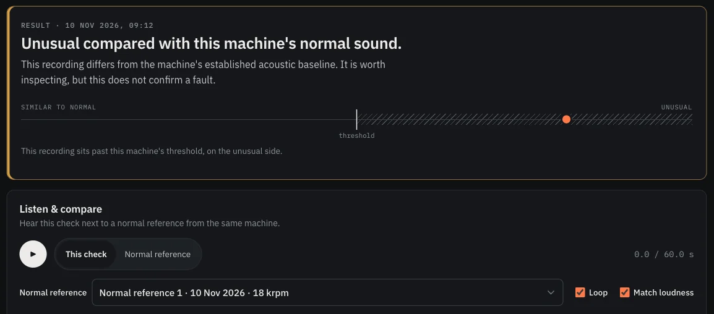
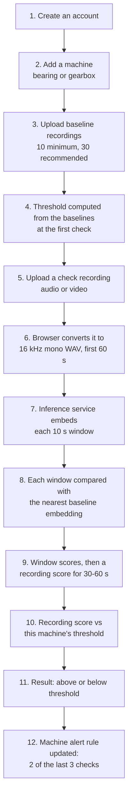
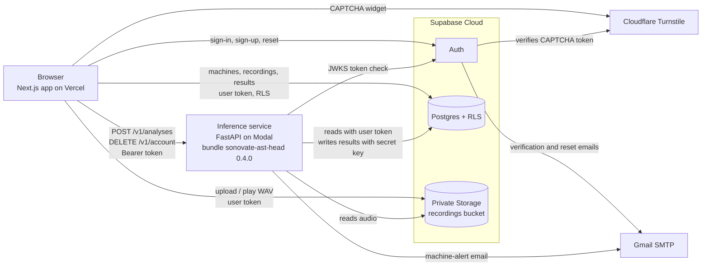
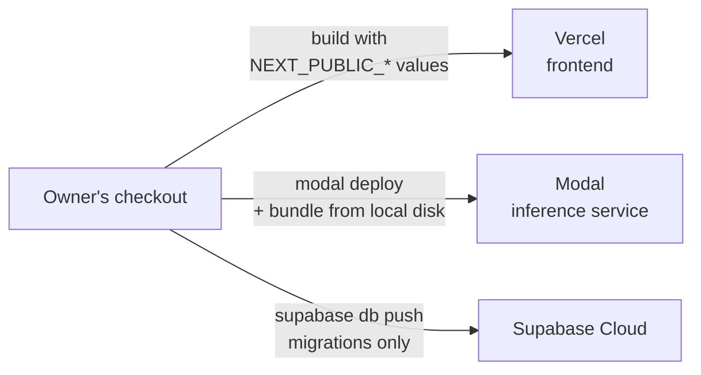

# Sonovate

**Every machine has a sound. Know when it changes.**

Sonovate is a web-based acoustic machine monitoring and anomaly screening prototype. You record a
machine while it runs normally, and Sonovate learns that machine's own baseline. Each new recording
is then compared with those normal recordings and placed above or below a threshold set for that
machine.

| | |
|---|---|
| **Repository** | [`Neemayg/Sonovate`](https://github.com/Neemayg/Sonovate) |
| **Live app** | <https://sonovate-mauve.vercel.app/> |
| **Status** | Research prototype. Deployed (Supabase Cloud, Modal, Vercel) and production-verified on 2026-11-14, with some checks still open ([Roadmap](#roadmap)). |
| **Model** | `sonovate-ast-head` 0.4.0 (frozen Audio Spectrogram Transformer + small head) |


> Sonovate is an anomaly *screening* tool. It does not diagnose faults, name a failing part, give a
> failure probability or predict remaining useful life. It misses many anomalies and sometimes flags
> normal recordings. **No alert does not mean the machine is healthy.**



*Result page from the local demo account (public MIMII DG recordings).*

---

## Contents

- [Overview](#overview)
- [Key features](#key-features)
- [How it works](#how-it-works)
- [Machine-learning approach](#machine-learning-approach)
- [System architecture](#system-architecture)
- [Tech stack](#tech-stack)
- [Repository structure](#repository-structure)
- [Local development](#local-development)
- [Demo and test data](#demo-and-test-data)
- [Testing](#testing)
- [Deployment](#deployment)
- [Security and privacy](#security-and-privacy)
- [Research evidence and limitations](#research-evidence-and-limitations)
- [Documentation](#documentation)
- [Contributing](#contributing)
- [Roadmap](#roadmap)
- [Licence and acknowledgements](#licence-and-acknowledgements)
- [Contact](#contact)

---

## Overview

Rotating machines such as bearings and gearboxes often sound different before anything is visibly
wrong. A person who knows a machine can hear when it "sounds off", but that knowledge is hard to
share and hard to track over time. Sonovate makes the comparison repeatable: it holds a set of
normal recordings for each machine and checks every new recording against that set.

**Who it is for:** technicians, maintenance engineers and researchers who want a simple,
per-machine acoustic check, and evaluators interested in how far a frozen pretrained audio model
gets on this task.

**Two kinds of recording:**

| Recording | What it is | What Sonovate does with it |
|---|---|---|
| **Baseline** (normal reference) | The machine running normally. At least 10 per machine, 30 recommended, up to 50. | Builds the machine's normal reference and its threshold. Baselines are never analysed themselves. |
| **Check** | A new recording of the same machine, 10–60 s. | Compared with the machine's baselines and placed above or below its threshold. |

Only **bearing** and **gearbox** machines are analysed, because those are the only types with
evidence. Machines of type **other** can be registered and store recordings, but get no results.

---

## Key features

### Machine management
- Two-step **Add machine** flow (type, then name, location and notes), with no default type.
- Machine page that adapts to its state: setting up (fewer than 10 baselines), monitoring, or alert.
- Per-machine **sensitivity** setting: *Standard* (default) or *High*.
- Edit and delete machines and recordings, with typed or two-step confirmation.

### Acoustic analysis
- **Audio or video upload.** The browser converts any file it can decode (for example WAV, MP3,
  M4A, MP4, MOV) to 16 kHz mono 16-bit WAV, keeping the first 60 s. Only that WAV is uploaded; the
  original file never leaves the device ([`frontend/src/lib/convert.ts`](frontend/src/lib/convert.ts)).
- **Batch baseline upload** with drag-and-drop, per-file status and retry of failed files only.
- **One-step machine check:** upload, then analysis starts automatically, with the real stages shown.
- **Windowing:** each check is cut into 10 s windows; every window is scored and stored.
- **Recording-level result** for 30–60 s checks (mean of the window scores, see
  [ADR-012](docs/DECISIONS.md#adr-012--judge-recordings-of-30-s-or-more-on-the-average-of-their-10-s-windows)).
- Optional **operating conditions** (bearing speed; gearbox voltage and load; free-form readings)
  stored with each recording for your records. **They are not used by the model.**

### Monitoring
- **Dashboard** with four exact counts (machines, needing attention, analyses in the last 7 days,
  ready for a check), one recommended next step, a compact machine table and recent activity
  (analyses, machine alerts, baseline uploads).
- Status words that never say "healthy": *Baseline incomplete*, *Ready for first check*,
  *No current machine alert*, *Repeated unusual readings*, *Records only*.
- **Result page** ordered what happened → this machine's checks → what it means → what to do next:
  *Above threshold* (unusual compared with this machine's baseline) or *Within threshold* (not flagged
  by this analysis) with the actual score and the threshold applied, previous / next check, and
  collapsed window scores and technical details.
- **Comparison chart** of a machine's analysed checks: one marker per check, the threshold applied
  to each check, above / within filter, tooltips, and markers that open the recording.
- **Listen & compare:** play the check next to a normal reference, with the frequency band of the
  largest difference shaded. This is a descriptive view, not a fault locator.
- **History** table with filters, expandable rows and **CSV export**.
- **Machine alert** when at least 2 of the last 3 checks are above threshold
  ([ADR-009](docs/DECISIONS.md#adr-009--over-time-machine-alert-2-of-the-last-3-analyses-above-threshold)),
  tracked as alert episodes.

### Account and security
- Email and password sign-in, email verification (on in production), password reset (`/auth/reset`).
- Optional Google sign-in (off by default; local setup in [`frontend/README.md`](frontend/README.md)).
- Cloudflare Turnstile CAPTCHA on sign-in, sign-up and password reset in production.
- Private audio storage and row-level security on every table.
- Account deletion that removes every audio file and then the user and all their data.
- Light, Dark (default) and System themes.

### Notifications
- **Machine-alert email** to the machine owner, sent once when an alert episode starts.
- Per-account preference on the Account page (default on).
- Delivery status shown on the machine's alert card: sent, failed, skipped by preference, or
  skipped because email is not configured.
- There is no in-app notification centre.

---

## How it works



The threshold is computed by the inference service at the first check and recomputed whenever the
set of baselines changes.

Sonovate reports at three levels. They answer different questions and should not be mixed up:

| Level | What it is | How it is decided |
|---|---|---|
| **Window** | One 10 s slice of a check. | Log of the cosine distance to the nearest baseline embedding. Shown as bars on the result page. Windows do not locate a fault. |
| **Recording** | One check (10–60 s). | 10–29 s: judged on the window score, or the mean of two windows, with the single-window threshold. 30–59 s and 60 s: mean of the window scores against a threshold with its own spread. The result is *above* or *below threshold*. |
| **Machine** | The machine over time. | Alert when at least 2 of the machine's last 3 analysed checks are above threshold. A single above-threshold check is shown but does not raise an alert. |

---

## Machine-learning approach

The product model is fixed by accepted decisions in [`docs/DECISIONS.md`](docs/DECISIONS.md). It
must not change without a new reviewed decision.

### Model

| Part | What it does | Decision |
|---|---|---|
| Encoder | Pretrained Audio Spectrogram Transformer (`MIT/ast-finetuned-audioset-10-10-0.4593`, BSD-3), **first 4 layers only, frozen**. | ADR-010 |
| Pooling | Frequency-preserving: layer-4 patch tokens averaged over time for each of the 12 frequency rows (12 × 768 = 9,216 values). | ADR-010 |
| Head | Small condition-classifier network trained on MIMII DG `train`/`adaptation` clips only; outputs a 128-value L2-normalised embedding. | ADR-010 |
| Scoring | Cosine distance from each window to the **nearest of this machine's own baseline embeddings** (k = 1). | ADR-008, ADR-010 |
| Threshold | Per machine: mean + spread × standard deviation of the baselines' leave-one-out log distances. Spread 1.5 for single 10 s windows. | ADR-011 |
| Long recordings | 30–59 s judged on the mean window score with spread 1.0; 60 s with spread 0.75. | ADR-012 |
| Baseline count | With 20 or more baselines, smaller Standard spreads keep false alarms at about the 10-baseline level and catch more anomalies (30 baselines: gearbox 1.30 / 0.80 / 0.60, bearing 1.30 / 0.85 / 0.60 for 10 / 30 / 60 s). | ADR-015 |
| Sensitivity | *Standard* uses the spreads above. *High* uses looser spreads (gearbox 1.00 / 0.75 / 0.50, bearing 1.25 / 0.75 / 0.50 for 10 / 30 / 60 s). It catches more anomalies and flags about twice as many normal recordings. | ADR-014 |
| Machine alert | At least 2 of the last 3 checks above threshold. Chosen on **simulated timelines**, not real machine histories. | ADR-009 |
| Bearing scoring | Bearings are scored with a fusion of the head embedding and the frozen layer-4 feature. Included in bundle 0.4.0. | ADR-013 (**proposed**, not yet accepted) |

All of the above are *Accepted* except ADR-013, which is still *Proposed*.

### Model bundle

The service loads one versioned bundle, **`sonovate-ast-head` 0.4.0** (weights identical to 0.3.0
and 0.3.1; 0.4.0 adds the bearing fusion fields). The bundle is pinned by name, version and
`bundle.json` sha256 in `ALLOWED_BUNDLES` ([`backend/app/bundle.py`](backend/app/bundle.py)), and
`bundle.json` pins the sha256 of every other file. Any mismatch stops the service from loading it.

### What the model does not use

Operating conditions (speed, voltage, load, other readings) are **stored metadata, not model
inputs**. The project began by asking whether environmental and operating context helps; on the
available data it gave no measurable gain (EXP-003, EXP-004), so the product model is audio-only
([ADR-006](docs/DECISIONS.md#adr-006--product-model-is-audio-only-context-is-shown-not-modelled)).

---

## System architecture

| Component | Technology | Location | Hosted on |
|---|---|---|---|
| Web app | Next.js 16, React 19, TypeScript, client-rendered pages | [`frontend/`](frontend/) | Vercel |
| Inference service | Python 3.12, FastAPI, Uvicorn | [`backend/`](backend/) | Modal |
| Model runtime | PyTorch, Hugging Face Transformers (AST), CPU only | [`backend/app/`](backend/app/) | Modal (bundle baked into the image) |
| Database, auth, storage | Supabase: Postgres with RLS, Auth, private Storage bucket, `pg_cron` | [`supabase/`](supabase/) | Supabase Cloud |
| Research pipeline | Python, `uv`, PyTorch, Transformers | [`ml/`](ml/), [`configs/`](configs/), [`tests/`](tests/) | Local only |
| Email | Gmail SMTP (auth emails from Supabase; alert emails from the inference service) | — | Gmail |
| CAPTCHA | Cloudflare Turnstile (widget in the browser, verified by Supabase Auth) | — | Cloudflare |

The inference service has its own `pyproject.toml` and does not import `ml/`.



The browser never talks to the model directly and never holds a secret key. The inference service
reads recordings with the caller's own token (so RLS applies), re-checks ownership, and writes
predictions, thresholds and baseline embeddings with the server-side secret key. More detail:
[`docs/ARCHITECTURE.md`](docs/ARCHITECTURE.md) and [`backend/README.md`](backend/README.md).

---

## Tech stack

| Area | Used |
|---|---|
| Frontend | Next.js 16.4, React 19.3, TypeScript 5, `@supabase/supabase-js` 2.118, one stylesheet with design tokens (`src/app/globals.css`), IBM Plex via `next/font` |
| Backend | Python 3.12, FastAPI, Uvicorn, HTTPX, PyJWT (ES256/RS256 via JWKS), `smtplib` for alert email |
| ML | PyTorch 2.15, Transformers 5.22 (AST), NumPy, SciPy, soundfile, matplotlib, `imageio-ffmpeg` (research analysis tool) |
| Database and storage | Supabase Postgres (RLS, triggers, views, `pg_cron`), Supabase Auth, Supabase Storage |
| Infrastructure | Vercel (frontend), Modal (inference), Supabase Cloud, Gmail SMTP, Cloudflare Turnstile, Docker image for the service ([`backend/Dockerfile`](backend/Dockerfile)) |
| Testing and tooling | `uv`, pytest, Node's built-in test runner (`node --test`), ESLint 9 with `eslint-config-next`, `tsc`, pgTAP via the Supabase CLI |

---

## Repository structure

```text
Sonovate/
├── frontend/                 Next.js web app
│   ├── src/app/              Routes: /, /login, /guide, /machines, /machines/new,
│   │                         /machines/[id], /machines/[id]/history, /recordings/[id],
│   │                         /account, /auth/callback, /auth/reset
│   ├── src/components/       UI components (Brand, uploaders, ListenCompare, ...)
│   ├── src/lib/api.ts        The only module that talks to Supabase and the inference service
│   ├── src/lib/convert.ts    In-browser conversion to 16 kHz mono WAV
│   ├── scripts/              Local seeders (seed-demo.mjs, seed-test-data.mjs)
│   ├── tests/                Unit tests for pure helpers (node --test)
│   └── .env.example
├── backend/                  FastAPI inference service (own pyproject.toml, uv.lock)
│   ├── app/main.py           App factory: /v1/health, /v1/analyses, /v1/account
│   ├── app/bundle.py         Bundle allow-list and sha256 verification
│   ├── app/alerts.py         Machine-alert email
│   ├── deploy/modal_app.py   Modal deployment
│   ├── tests/
│   ├── Dockerfile
│   └── .env.example
├── ml/                       Research pipeline (data prep, experiments, export, analyze.py)
├── configs/                  JSON configs for every experiment and export
├── tests/                    ML tests (uv run pytest from the repository root)
├── supabase/
│   ├── migrations/           Schema, RLS, caps, upload completion, alert email
│   ├── templates/            Branded auth email templates
│   ├── tests/                pgTAP and Node isolation tests
│   ├── config.toml
│   └── seed.sql              Local test user only; never run in production
├── docs/                     Project state, decisions, experiments, datasets, deployment
├── pyproject.toml            Root ML project
└── CLAUDE.md                 Working rules for AI-assisted development
```

Git-ignored and never committed: `artifacts/` (model bundles), `data/raw/`, `data/interim/`,
`data/processed/`, all audio (`*.wav`, `*.mp3`, ...), archives, and every `.env` file except
`.env.example`.

---

## Local development

### Prerequisites

| Tool | Version | Notes |
|---|---|---|
| Git | any recent | |
| Python | 3.12 or later | `requires-python = ">=3.12"` in both `pyproject.toml` files |
| [uv](https://docs.astral.sh/uv/) | recent | Manages both Python environments |
| Node.js and npm | Node 20 or later (needs confirmation) | No `engines` field; `@types/node` is `^20` |
| Docker | running | Required by the local Supabase stack |
| Supabase CLI | 2.122.0 | Run through `npx supabase@2.122.0`; no global install needed |

### 1. Clone

```bash
git clone https://github.com/Neemayg/Sonovate.git
```

```bash
cd Sonovate
```

### 2. Environment variables

Copy each `.env.example` and fill in the values. `npx supabase@2.122.0 status` prints the local
keys. Never commit a filled-in `.env` file.

**Frontend** — `frontend/.env.local` from [`frontend/.env.example`](frontend/.env.example). All of
these are **public**: they are built into the browser bundle.

| Variable | Purpose |
|---|---|
| `NEXT_PUBLIC_SUPABASE_URL` | Supabase API URL (also added to the CSP) |
| `NEXT_PUBLIC_SUPABASE_PUBLISHABLE_KEY` | Supabase publishable key (never a secret key) |
| `NEXT_PUBLIC_INFERENCE_API_URL` | Inference service URL (also added to the CSP) |
| `NEXT_PUBLIC_TURNSTILE_SITE_KEY` | Turnstile site key; leave empty locally |
| `NEXT_PUBLIC_SITE_URL` | Public origin for social-sharing images; unset locally |

**Inference service** — `backend/.env` from [`backend/.env.example`](backend/.env.example).

| Variable | Visibility | Purpose |
|---|---|---|
| `SUPABASE_URL` | public | Must be https unless it points at localhost |
| `SUPABASE_PUBLISHABLE_KEY` | public | |
| `SUPABASE_SECRET_KEY` | **server only** | Writes results, thresholds and embeddings; deletes accounts. Required when bundles are configured |
| `SONOVATE_BUNDLES_DIR` | server | Directory holding the bundle. Unset = no model (`503 no_validated_model`) |
| `CORS_ORIGINS` | server | Allowed frontend origins (default `http://localhost:3000`) |
| `SONOVATE_ANALYSES_PER_WINDOW`, `SONOVATE_RATE_WINDOW_SECONDS` | server | Per-user rate limit (default 20 per 600 s, per process) |
| `SONOVATE_EMBED_CONCURRENCY` | server | Transformer passes at once per process (default 1) |
| `SMTP_HOST`, `SMTP_PORT`, `SMTP_USERNAME`, `SMTP_PASSWORD` (**server only**), `ALERT_EMAIL_FROM` | server | Machine-alert email. Set all or none; `SMTP_PORT` defaults to 465 |
| `SITE_URL` | server | Frontend origin used for links in alert emails (default `http://localhost:3000`) |

The SMTP variables and `SITE_URL` are read by [`backend/app/config.py`](backend/app/config.py) but
are not listed in `backend/.env.example`. Without them, alerts are still recorded, with email
status `skipped_unconfigured`.

**Supabase (optional, Google sign-in only)** — `supabase/.env` from
[`supabase/.env.example`](supabase/.env.example): `SUPABASE_AUTH_EXTERNAL_GOOGLE_CLIENT_ID` and
`SUPABASE_AUTH_EXTERNAL_GOOGLE_CLIENT_SECRET` (server only).

### 3. Start Supabase

From the repository root (Docker must be running):

```bash
npx supabase@2.122.0 start
```

This applies all migrations and `supabase/seed.sql`. Useful follow-ups:

```bash
npx supabase@2.122.0 status
```

```bash
npx supabase@2.122.0 db reset
```

Local URLs: API `http://127.0.0.1:54321`, Studio `http://127.0.0.1:54323`, local email viewer
`http://127.0.0.1:54324` (emails are captured, not sent). Email confirmation is off locally.

### 4. Start the inference service

```bash
cd backend
cp .env.example .env
uv sync
uv run --env-file .env uvicorn app.main:create_app --factory --port 8000
```

Health check: `http://localhost:8000/v1/health`. Without a bundle the service runs but every analysis
returns `503 no_validated_model`.

### 5. Start the frontend

```bash
cd frontend
cp .env.example .env.local
npm install
npm run dev
```

Open `http://localhost:3000`. The local seed creates a test user `tech@sonovate.test` (password in
[`frontend/README.md`](frontend/README.md); local only), or you can sign up on the sign-in page.

### 6. Model bundle

The bundle (about 140 MB for 0.4.0) is **not in git**: it holds model weights, which the project
never commits. The service looks for it at `$SONOVATE_BUNDLES_DIR/sonovate-ast-head-0.4.0/`; the
ML export writes to `artifacts/bundles/` by default. The directory must contain a `bundle.json`
whose sha256 matches the pin in `ALLOWED_BUNDLES`, and every file it lists must match its sha256.
Any other directory is ignored.

**How to obtain it: needs confirmation.** There is no published download. The documented route
rebuilds it from the research pipeline, which needs the MIMII DG archives (see
[`docs/DATASET_REGISTER.md`](docs/DATASET_REGISTER.md)):

```bash
uv run python -m ml.prepare --config configs/mimii_dg.json
```

```bash
uv run python -m ml.export_ast_head --config configs/export_ast_head.json
```

```bash
uv run python -m ml.rebundle --config configs/rebundle_0_3_1.json
```

```bash
uv run python -m ml.rebundle --config configs/rebundle_0_4_0.json
```

The first export writes 0.3.0; the rebundle steps derive 0.3.1 and then 0.4.0. Target bundle
directories must not exist yet. Whether a rebuild reproduces the pinned sha256 byte for byte has
not been confirmed; if it does not, the service will refuse the bundle. Contributors without the
bundle can still run the app (no results) and the tests (parity tests are skipped and say why).

---

## Demo and test data

Both seeders run only against a local stack (`localhost` / `127.0.0.1`) and need Supabase, the
inference service **with the bundle**, and `frontend/.env.local`. They use public **MIMII DG**
clips (Zenodo 6529888, CC-BY-4.0) from its `test` split, which the model was not trained on.

| Command | Creates | Data needed |
|---|---|---|
| `npm run seed:demo` | Account `demo@sonovate.test` with three machines: *Gearbox, line 2* and *Pump bearing* (30 baselines, 3 normal and 3 anomaly checks each, one of each 60 s), and *Conveyor bearing (new)* with 4 of 10 baselines | Full MIMII DG in `data/raw/mimii_dg`, or `SONOVATE_DEMO_DATA_DIR` |
| `npm run seed:test-data` | Account `testdata@sonovate.test` with a bearing and a gearbox machine (10 baselines, 3 normal and 3 anomaly checks each), plus 12 never-uploaded files in `data/interim/manual_uploads/` for manual testing | None: downloads only the 84 clips it uses (about 17 MB) from Zenodo and checks each one |

Run them from `frontend/`. Reset behaviour:

- `npm run seed:demo` stops if the demo account already has machines; `-- --reset` replaces them.
- `npm run seed:test-data` is idempotent; `-- --reset` replaces the test account's machines only.

Account e-mails and passwords can be overridden with `SONOVATE_DEMO_EMAIL` /
`SONOVATE_DEMO_PASSWORD` and `SONOVATE_TEST_DATA_EMAIL` / `SONOVATE_TEST_DATA_PASSWORD`.

The 60 s files are built by joining six separate 10 s clips of the same label, because MIMII DG has
no 60 s recordings. File names keep the dataset label, so hits and misses are visible. **Seeded
results are real model outputs on lab data; they are a demonstration, not an industrial
validation.** A separate research demo (`ml/demo_seed.py`) is described in
[`docs/DEMO.md`](docs/DEMO.md).

---

## Testing

| Area | Command (run from) | Notes |
|---|---|---|
| Frontend unit tests | `npm test` (`frontend/`) | Pure helpers in `src/lib` |
| Frontend types | `npm run typecheck` (`frontend/`) | `next typegen` then `tsc --noEmit` |
| Frontend lint | `npm run lint` (`frontend/`) | ESLint |
| Frontend build | `npm run build` (`frontend/`) | Production build |
| Inference service | `uv run pytest` (`backend/`) | Parity tests need `SONOVATE_BUNDLES_DIR`; otherwise skipped |
| Database (RLS, caps, alerts, deletion cascade) | `npx supabase@2.122.0 test db` (root) | pgTAP: `supabase/tests/database/*.test.sql` |
| Storage isolation | `SUPABASE_PUBLISHABLE_KEY=<key> node supabase/tests/storage_api_isolation.mjs` (root) | Needs the local stack |
| Account deletion end to end | `SUPABASE_PUBLISHABLE_KEY=<key> SUPABASE_SECRET_KEY=<key> node supabase/tests/account_deletion.mjs` (root) | Needs the local stack and the running inference service; creates a throwaway user |
| ML pipeline | `uv run pytest` (root) | |
| Service in Linux | `docker build --target test -t sonovate-inference:test backend` | Run with the bundle mounted at `SONOVATE_BUNDLES_DIR` |

When this README was written (commit `6ab9a46`), `npm test` (26 passed) and the root
`uv run pytest` (155 passed) were run. The other suites were not re-run for this README; the latest
recorded results are in [`docs/PROJECT_STATE.md`](docs/PROJECT_STATE.md).

---

## Deployment

The live stack, deployed on 2026-11-14:



The Vercel project is connected to GitHub: every push to `main` builds and publishes a production
deployment (root directory `frontend`). The inference service and database migrations are deployed by
hand with the Modal and Supabase CLIs.

| Part | Host | Key points |
|---|---|---|
| Frontend | Vercel (Hobby) | `https://sonovate-mauve.vercel.app`; `NEXT_PUBLIC_*` values set for Production and baked in at build time |
| Inference service | Modal | `modal deploy backend/deploy/modal_app.py` with `SONOVATE_BUNDLES_SRC` pointing at the bundle; one container, 2 CPU, 4 GiB, 150 s timeout, scales to zero; config and secrets in Modal secrets |
| Database, Auth, Storage | Supabase Cloud | **Migrations only.** Never run `supabase/seed.sql` in production (it creates a test user with a published password) |
| Auth email | Gmail SMTP | Configured in Supabase Auth; branded templates in [`supabase/templates/`](supabase/templates/) |
| CAPTCHA | Cloudflare Turnstile | Site key in Vercel; secret key in Supabase Auth |

Local and deployed differ: locally, email confirmation and CAPTCHA are off, Supabase runs over http,
and `npm run dev` is used because a production build sends `upgrade-insecure-requests` and needs
https backends. The full checklist, host choices, measured cold starts and Stage 7 results are in
[`docs/DEPLOYMENT.md`](docs/DEPLOYMENT.md). No secrets are stored in the repository.

---

## Security and privacy

What is implemented (see [`docs/ARCHITECTURE.md`](docs/ARCHITECTURE.md) and
[`docs/DEPLOYMENT.md`](docs/DEPLOYMENT.md) for detail):

- **Row-level security** on every table with per-owner policies. Child rows are tied to their parent
  by composite `(parent_id, owner_id)` foreign keys. `anon` has no table privileges, and
  `authenticated` gets only the columns it needs.
- **Private storage:** audio lives at `<owner_id>/<machine_id>/<recording_id>.wav` in a private
  bucket (2 MiB limit, WAV types only), with no update policy.
- **Upload completion:** a recording counts only once its file is stored (`upload_completed_at`, set
  by a storage trigger and not writable by users). Incomplete uploads are ignored everywhere
  (`409 upload_incomplete`), and a `pg_cron` job removes them after an hour.
- **Caps and rate limits:** at most 50 baselines per machine and 500 recordings per user; one
  analysis in flight per user and 20 analyses per 10 minutes by default (per process).
- **Protected inference:** Supabase access tokens are verified against JWKS (ES256/RS256; issuer,
  audience, expiry, role); requests without a valid token get 401; CORS allows only the frontend
  origin. Errors never include paths or stack traces.
- **Secret handling:** only the publishable key reaches the browser. The secret key and SMTP
  password live only in server-side secret stores.
- **Auth:** minimum password length 10 (production also requires letters and digits), email
  confirmation and Turnstile CAPTCHA in production. Leaked-password protection is **not** enabled
  (Supabase Pro only).
- **Security headers:** CSP, `X-Frame-Options: DENY`, `nosniff`, referrer and permissions
  policies, and HSTS in production builds (`frontend/next.config.ts`). The CSP still allows
  `'unsafe-inline'` scripts for Next.js bootstrapping.
- **Account deletion** removes every stored audio file, then the auth user; the database cascades.

Stage 7 production checks (2026-11-14) confirmed headers, https redirects, no secrets in the
frontend bundles, and isolation between a second user and the owner. A live browser test with a
second real account, end-to-end account deletion on the deployed stack, and a real alert email
were **not** verified. This is a research prototype and has not had an independent security audit.

Never commit `.env` files, keys, audio, datasets or model weights.

---

## Research evidence and limitations

Sonovate is a **research prototype**. It does not diagnose faults, identify components, give a
failure probability or predict remaining useful life. There are no run-to-failure recordings, so
remaining-life claims are impossible with this data.

Held-out results from the experiment log, 10 baseline recordings per machine, Standard sensitivity,
bundle 0.4.0:

| Check | Anomalous recordings flagged | Normal recordings flagged | Test data | Source |
|---|---|---|---|---|
| Gearbox, 60 s | about 42% | about 9% | MIMII DUE evaluation (third use) | EXP-026 |
| Gearbox, 10 s | about 25% | about 9% | MIMII DUE evaluation (third use) | EXP-026 |
| Bearing, 60 s | about 43% | about 9% | DCASE 2022 bearing (reused; weak evidence) | EXP-029 |
| Bearing, 10 s | about 18% | about 9% | DCASE 2022 bearing (reused; weak evidence) | EXP-029 |

With **High** sensitivity (EXP-032), 60 s gearbox checks flag about 57% of anomalies, but about 17%
of normal recordings.

With **30 baselines** (EXP-033, ADR-015, same held-out sets), Standard keeps normal recordings flagged
at about 9% and flags about 57% (gearbox) and 72% (bearing, weak evidence) of anomalous 60 s
recordings, and about 31% of anomalous 10 s clips.

Read these figures with their caveats:

- **Lab data only:** recordings of bearings and gearboxes with deliberately induced faults. Real
  machines, microphones and rooms may give lower results. No recordings of real machines have been
  collected yet ([`docs/DATA_COLLECTION.md`](docs/DATA_COLLECTION.md) has the protocol).
- **Test-set reuse:** the held-out sets had been used before, so they are supporting evidence, not
  a clean first test.
- **Pseudo-recordings:** 30 s and 60 s figures come from recordings joined from separate 10 s clips,
  which may be optimistic.
- **Missed anomalies and false alarms:** most anomalies in a single 10 s clip are missed, and about
  1 in 11 normal recordings is flagged at Standard sensitivity.
- **The alert rule** was chosen on simulated timelines, not real machine histories.
- **No other machine types** have evidence, which is why only bearings and gearboxes are analysed.

The in-app guide explains this for users: [`/guide#evidence`](https://sonovate-mauve.vercel.app/guide#evidence).
Full methods and results: [`docs/EXPERIMENT_LOG.md`](docs/EXPERIMENT_LOG.md),
[`docs/DECISIONS.md`](docs/DECISIONS.md), [`docs/DATASET_REGISTER.md`](docs/DATASET_REGISTER.md).

---

## Documentation

| Document | Contents |
|---|---|
| [`docs/PROJECT_STATE.md`](docs/PROJECT_STATE.md) | Current phase, completed work, blockers, next actions |
| [`docs/PROJECT_CONTEXT.md`](docs/PROJECT_CONTEXT.md) | Original problem statement, scope and non-claims |
| [`docs/ROADMAP.md`](docs/ROADMAP.md) | Phased research and build plan |
| [`docs/DECISIONS.md`](docs/DECISIONS.md) | Architecture and model decisions (ADR-000 to ADR-015) |
| [`docs/EXPERIMENT_LOG.md`](docs/EXPERIMENT_LOG.md) | Every experiment with method, results and caveats |
| [`docs/DATASET_REGISTER.md`](docs/DATASET_REGISTER.md) | Datasets, licences, provenance and split protocol |
| [`docs/ARCHITECTURE.md`](docs/ARCHITECTURE.md) | Implemented system design |
| [`docs/DEPLOYMENT.md`](docs/DEPLOYMENT.md) | Production settings, hosts and verification results |
| [`docs/DATA_COLLECTION.md`](docs/DATA_COLLECTION.md) | Protocol for recording real machines |
| [`docs/ANALYZE.md`](docs/ANALYZE.md) | Command-line analysis of one audio or video recording (`ml/analyze.py`) |
| [`docs/TRAINING_PLAN.md`](docs/TRAINING_PLAN.md) | Research plan for a stronger audio model |
| [`docs/DEMO.md`](docs/DEMO.md) | Research demo with public recordings |
| [`frontend/README.md`](frontend/README.md) | Frontend layout, scripts, seeders and Google sign-in |
| [`backend/README.md`](backend/README.md) | Inference service, API errors and security notes |

---

## Contributing

1. Fork the repository, then clone your fork.
2. Create a branch for one bounded change.
3. Keep changes small, typed and testable. Do not add dependencies without saying why.
4. Run the checks for the parts you touched (see [Testing](#testing)) and report the real results.
5. Update the relevant docs: `docs/ARCHITECTURE.md` when the design changes, and
   `docs/EXPERIMENT_LOG.md` for any experiment.
6. Open a pull request that explains what changed, how it was checked and what it does not cover.
   Use GitHub issues for bugs and proposals.

Rules that protect the research:

- Changes to the **model, thresholds, scoring or alert rule** need review and a new or updated ADR
  in [`docs/DECISIONS.md`](docs/DECISIONS.md), supported by a reproducible experiment on suitable
  held-out data.
- Never fabricate data, labels, metrics or results. Never call an anomaly score a probability or a
  health score.
- Split data by the right independent unit (machine, section, session) to prevent leakage, and
  record any test-set reuse.
- Never commit datasets, audio, credentials or model weights.

[`CLAUDE.md`](CLAUDE.md) lists the full working rules used for AI-assisted development in this
repository.

---

## Roadmap

**Done**

- Dataset audit, reproducible data pipeline and research experiments (EXP-001 to EXP-033).
- Product model `sonovate-ast-head` 0.4.0 with per-machine thresholds, recording-level rules,
  sensitivity setting and the 2-of-3 machine alert.
- Web app: onboarding, batch baselines, checks, monitoring workspace, result page, Listen &
  compare, history with CSV export, guide, themes.
- Upload-integrity fix, machine-alert email, branded auth emails.
- Cloud deployment on Supabase Cloud, Modal and Vercel, with Gmail SMTP and Turnstile.

**In progress**

- Stage 7, production and security verification: main checks done; a second-account browser test,
  end-to-end account deletion on the deployed stack and a real alert email are still open.
- Stage 8, handover.
- Owner decision pending: acceptance of ADR-013 (bearing fusion).

**Possible future work** (ideas, not commitments)

- Recordings of real machines, to measure real-world performance and get timestamped data for
  validating the alert rule.
- A fresh, untouched test set (for example DCASE 2023/2024, after a licence check) before any model
  change.
- Better bearing performance.
- Transactional uploads and server-side summaries for larger accounts.

---

## Licence and acknowledgements

**Licence:** no `LICENSE` file exists in this repository, so no licence is granted for the code.
Ask the owner before reusing it.

**Datasets** (see [`docs/DATASET_REGISTER.md`](docs/DATASET_REGISTER.md)):

| Dataset | Licence | Use in this project |
|---|---|---|
| MIMII DG (Dohi et al., 2022; [Zenodo 6529888](https://zenodo.org/records/6529888)) | CC-BY-4.0 | Model development, head training, demo and test-data seeders |
| MIMII DUE ([Zenodo 4740355](https://zenodo.org/records/4740355)) | CC-BY-NC-SA-4.0 | Held-out gearbox evaluation only |
| DCASE 2022 Task 2 evaluation data | Treated as CC-BY-NC-SA-4.0 (non-commercial) | Held-out evaluation only |

Dataset licences cover the datasets themselves. They do not give anyone the right to redistribute
the data through this repository, which contains none.

**Model and libraries:** Audio Spectrogram Transformer weights
`MIT/ast-finetuned-audioset-10-10-0.4593` (BSD-3-Clause); PyTorch; Hugging Face Transformers;
FastAPI; Next.js; React; Supabase. Thanks to the MIMII and DCASE organisers for publishing their
data and evaluation tools.

---

## Contact

- Repository and issues: <https://github.com/Neemayg/Sonovate>
- Live app: <https://sonovate-mauve.vercel.app/>
